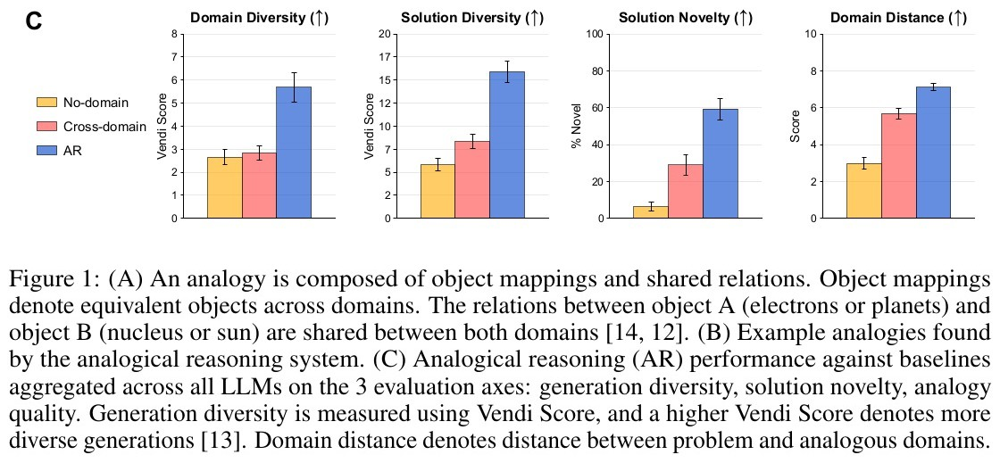
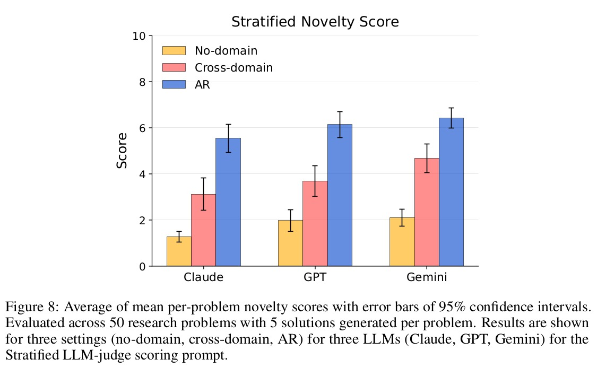
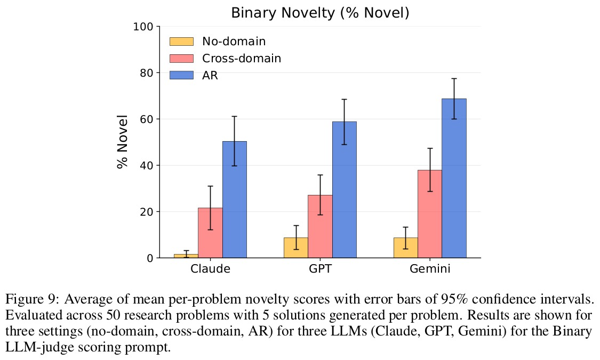
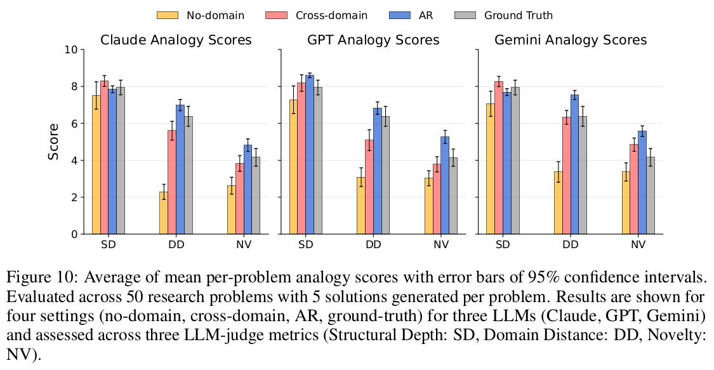
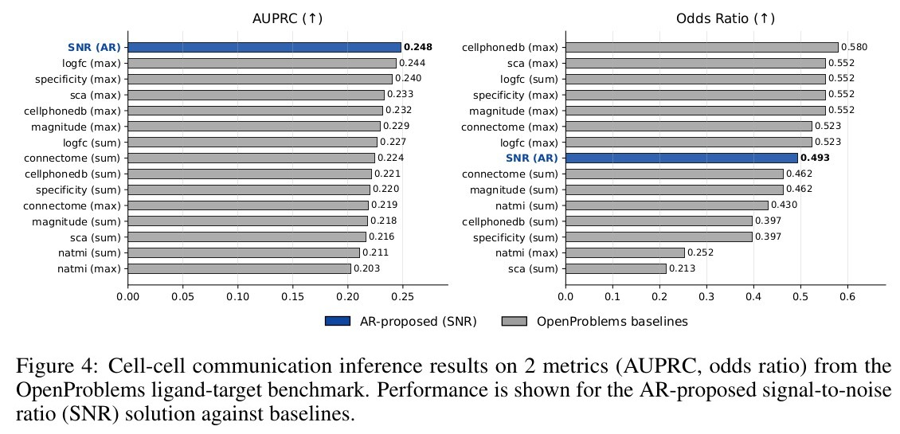

# Highlights

- **Mode collapse**: LLMs converge to the same few solutions, systematically quantified for the first time.
- **Analogical reasoning (AR)**: to address this, the LLM finds an analogy to another domain, then searches that domain for an existing method.
- **Evaluation**: generation diversity, solution novelty, and analogy quality on 50 biomedical problems from the **AR Dataset** (266 examples).
- **Results**:
  - solution diversity **+90% to 173%**
  - **50% to 69%** of solutions novel, compared with 2% to 9% for the no-domain baseline
  - 4 biomedical case studies competitive with published baselines



# Motivation

- **Autonomous science is advancing quickly:**
  - The AI Scientist: the entire pipeline, from ideation to manuscript generation.
  - Virtual Lab: novel COVID-19 binders.
  - Kosmos: novel mechanisms of aging.
  - AI co-scientist: promising disease targets.
- **All of these systems rely on LLMs that can propose solutions that are:**
  - **novel**, to move research past existing work
  - **diverse**, to tackle a problem from many angles

Two observations are particularly important:

- **LLMs collapse to a narrow set of generations.**
  - Diversity mode collapse, in which outputs converge to a narrow set of high-probability generations, is well documented.
  - In open-ended research tasks, it limits the search space of potential discoveries.
  - Prompting, decoding, and training techniques mitigate it, but approaches that enforce **structural and semantic** diversity remain an open opportunity.
- **Analogies transfer knowledge across distant domains.**
  - In cognitive science, analogical reasoning transfers knowledge between domains through shared relational structure.
  - LLMs exhibit a latent ability to perform it.
  - It has been applied to software engineering, mathematical proof generation, and automated classification of diseases.
  - Its application to solution generation in autonomous science is unexplored.

**The idea of AR:** instead of searching directly for a solution to its problem, the LLM searches for it in other domains that share the same relational structure.

# Method Overview

**Task:** open-ended solution generation, that is, generating a candidate solution to a research problem. The goal is to isolate the benefits of analogical reasoning.

## Analogies as structure mappings


Definition from **structure-mapping theory** [1]: an analogy maps knowledge from a base domain into a target domain through shared relational structure.

- **Objects**: entities that function as wholes at a given level of organization.
- **Relations**: predicates over two or more objects that express how they interact.
- **Attributes**: single-argument predicates that describe an object's properties. **They are not mapped across domains.**

Each AR analogy has two components:

- **object mappings**: objects of the research problem → objects of the analogous domain
- **shared relations**: a subset of the problem's relations that also hold in the analogous domain

## Analogical reasoning in two steps

Two LLM calls per generation, both at temperature 1.0.

### Step 1: extraction

A single call to an extraction agent, with two sub-goals:

1. **Extract the objects and relations of the problem**: it summarizes the problem and lists its key objects with their functional roles and the core relations between them.
2. **Find other domains**: it generates analogies, each with a target domain, object mappings with a rationale, and the shared relations.

Key instruction: map objects by **function**, not surface similarity.

- "Delivers payload": a valid basis.
- "Is liquid": not a valid basis.

### Step 2: search

One call per analogy: a search agent receives the problem and the analogy, with two sub-goals:

1. **Find a method**, real and existing, in the analogous domain that operates on the mapped objects and preserves the shared relations.
   - Direct biomedical solutions are **forbidden**.
   - A specific cited source with its exact title is required, plus GitHub repositories when available.
2. **Return this method and its source domain** as a candidate solution, with one solution per analogy.

## Baselines

AR is compared with two baselines, which the authors describe as "natural and strong approaches" because they reflect how users typically prompt LLMs for this kind of problem:

- **No-domain** (one call):
  - the LLM receives the problem and must find real, existing solutions, algorithms, or methods that could address it
  - no domain constraint: it can search anywhere, including biomedicine
- **Cross-domain** (two calls):
  1. the LLM receives the problem and must identify other domains (for example, computer science or logistics) that have relevant methods for addressing it
  2. for each domain, it must find real, existing solutions from that domain that could address the problem

**Difference between cross-domain and AR:** both search other domains with the same number of calls, but the cross-domain baseline picks a domain simply because it seems relevant, while AR must first extract the objects and relations of the problem and build an explicit analogy, then search for a method that operates on the mapped objects and preserves these relations.

## Evaluation axes

### Generation diversity

- **Vendi Score** [2]: the effective number of unique elements in a set.
- Computed with cosine similarity on text-embedding-3-small embeddings.
- Separately for the source domains and for the solutions.
- The number of unique domains and unique solutions is also counted.

### Solution novelty

- **Question:** has the candidate solution ever been applied to this specific research problem? The paper calls this pairing the "solution transfer".
- Judged against retrieved literature:
  - **Retrieval:** Claude Haiku 4.5 writes three Semantic Scholar queries per solution transfer, and each query returns its top-15 papers.
  - **Re-ranking:** SPECTER embedding similarity to a paper-like title and abstract rewritten from the solution transfer, keeping the top-10.
  - **Scoring:** a Claude Sonnet 4.5 judge at temperature 0 gives a stratified novelty score and a binary decision, novel or not novel.
- **Human pairwise preference study,** in addition to the LLM judge:
  - for each of the 50 problems, one AR solution and one cross-domain solution are shown side by side, in random order, to two biomedical AI researchers
  - they indicate which one is more novel, and whether each one is a reasonable approach (yes or no)
  - inter-annotator agreement is measured with Cohen's κ (0 = chance, 1 = perfect agreement)

### Analogy quality

A Claude Sonnet 4.5 judge scores each analogy.

- **Three main metrics:**
  - **Structural Depth**: how well-defined and meaningful the object mappings are
  - **Domain Distance**: the distance between the problem domain and the analogous domain
  - **Analogy Novelty**: the originality of the analogy
- **Three secondary metrics:** Applicability, Unexpectedness, and Non-Obviousness.
  - Applicability measures how well the analogy enables knowledge transfer to the problem.
- **Baselines:** they do not produce analogies, so an LLM extracts the implicit analogy of each solution after the fact. Solutions from the same domain as the problem (for example, AlphaFold2 in biology) have no analogy and are excluded.
- **Ground truth:** the analogy actually used in each AR Dataset paper.

## The AR Dataset

Published papers in which an analogy from another domain was the key insight behind a biomedical solution.

- **Discovery:** Perplexity Sonar Pro searches for up to 15 papers for every pair of 48 non-biomedical base domains and 47 biomedical target domains.
- **Verification:** each paper is verified with the Semantic Scholar and arXiv APIs, and rejected otherwise.
- **Annotation:** Claude Sonnet 4.5 extracts the research problem, the problem domain, the analogous domain, and the analogy, and rates the difficulty of the analogy.
- **Final size:** 266 examples.
- **Problem rewriting:** the original problem statements often leak hints about the analogous domain.
  - An LLM rewrites each evaluation problem without these hints.
  - All settings and all LLMs receive the same rewritten problems.

# Experiments

## Experimental setup

- **Evaluation set:** 50 research problems from the AR Dataset.
- **Settings:** AR, cross-domain, and no-domain (see Baselines).
- **LLMs:** Claude Sonnet 4.5, GPT-5.2, and Gemini 3 Flash, all at temperature 1.0.
- **Sample sizes:**
  - diversity: 50 generations per problem, or 150 when aggregated across the three LLMs
  - novelty and analogy quality: 5 generations per problem
- **Case studies:**
  - Perplexity Deep Research replaces the search agent.
  - Claude Code with Opus 4.6 implements one solution per problem with minimal human guidance.

## Part 1: quantitative results

*Evaluation on the 50 problems: the solutions are not implemented, they are scored by LLM judges.*

### Diversity


| Setting | Unique domains | Domain Vendi Score | Unique solutions | Solution Vendi Score |
|---|---|---|---|---|
| No-domain | 7.40 | 2.64 | 86.42 | 5.81 |
| Cross-domain | 7.90 | 2.84 | 98.96 | 8.34 |
| AR | **27.56** | **5.68** | **133.32** | **15.90** |

Averages over the 50 problems, with 150 generations per problem aggregated across the three LLMs. Higher is better.

**What is computed:**

- **Unique:** the number of distinct strings among the 150 generations.
- **Vendi Score:** the number of semantically distinct elements, from 1 (all the same) to 150 (all different).

**Results:**

- **The baselines mode collapse:** about 8 domains out of 150 generations, even for the cross-domain baseline, which is explicitly asked to search other domains.
  - Example for protein structure prediction: the five most frequent no-domain solutions are all AlphaFold2 variants, while AR solutions come from e-graphs, origami (Treemaker), or tensegrity structures.
- **AR roughly doubles domain diversity** (+100% to 115%) and raises solution diversity by **90% to 173%**, and remains the best with each LLM taken separately.

### Novelty





**What is computed:**

- **Stratified score:** a score from 0 (already applied to this problem) to 10 (never explored).
- **Binary score:** novel or not novel.

**Results:**

- **AR is the most novel with every LLM:** **50% to 69%** of solutions judged novel, compared with 22% to 38% for the cross-domain baseline and 2% to 9% for the no-domain baseline.
- **Human study:** four researchers judge AR more novel than the cross-domain baseline **78%** of the time (κ = 0.445).
- **Caveat:** AR solutions are judged reasonable **67%** of the time, compared with **86%** for cross-domain solutions.

### Analogies



**What is computed:**

- **SD, DD, NV:** scores from 0 to 10 given by an LLM judge for Structural Depth, Domain Distance, and Analogy Novelty.
- **Ground Truth:** the analogy from the published paper.

**Results:**

- **AR goes furthest and is the most original:** Domain Distance of 6.8 to 7.5 (compared with 2.3 to 3.4 for no-domain) and the highest Analogy Novelty, above the ground-truth analogies.
- **Comparable Structural Depth** across all settings.
- **Caveat:** AR is the least applicable (6.86 to 7.97, compared with 8.08 to 8.76 for the baselines).

## LLM judge validation

Both LLM judges are compared with human annotations.

- **Novelty judge:** tested on 98 NLP research ideas scored by experts [3], a different domain from biomedicine.
  - Spearman correlation of **0.36 to 0.43** with the experts, comparable to the 0.41 measured between two humans in prior work (Agentic Reviewer).
  - It differs from the experts as much as the experts differ from each other (1.70 against 1.73 points on average).
- **Analogy judge:** for each metric, humans compare 20 pairs of analogies, one scored high and one scored low by the LLM.
  - Agreement with the LLM of **89%** for Domain Distance and **76%** for Analogy Novelty.
  - Structural Depth: only **60%**, and the humans do not agree with each other (κ = -0.133). This metric is not reliable.

## Part 2: case studies

*Four biomedical case studies: one AR solution is actually implemented and tested.*

- **The principle:** one research problem in each of four biomedical areas.
- One promising solution per problem is implemented and compared with published baselines.
- **Caveat, hallucinated sources:** the case studies use Perplexity Deep Research because its grounded search reduces the source and codebase hallucinations observed with the other LLMs.


### 1. Perturbation effect prediction

*Srivatsan20 dataset of PerturBench [4]*

- **Problem:** existing models tend to learn the average response to a perturbation.
- **Analogy:** cells ↔ consumers who respond differently to the same monetary policy change.
- **Solution:** **finite mixture models (FMM)** from econometrics.
- **Results** on MMD PCA, a maximum mean discrepancy (MMD) computed in principal component analysis (PCA) space:
  - reproduced Latent Additive (LA) baseline: 1.65
  - FMM alone: **0.42**. The paper calls this state-of-the-art, although LA is its only comparison.
  - FMM combined with LA: **0.13**, nearly 13-fold below LA, with comparable prediction accuracy.
- **Caveat, the standalone FMM sacrifices accuracy:**
  - Cosine LogFC, the cosine similarity between predicted and observed log fold changes (LogFC): **0.08** for FMM alone, against **0.47** for LA
  - only the LA+FMM hybrid keeps accuracy comparable to LA (**0.45**) while improving the distributional metric

### 2. Cell-cell communication inference

*OpenProblems ligand-target benchmark [5]*

- **Problem:** most methods score interactions by ligand-receptor co-expression.
- **Analogy:** a true interaction ↔ a radio signal rising above a noise floor.
- **Solution:** **signal-to-noise ratio (SNR) analysis**.
  - It scores the downstream transcription-factor activity of the target cells against a permutation null.
  - It combines this score with co-expression.
- **Results:**
  - **best AUPRC** among 15 methods: 0.248 against 0.244 for the best of the 14 baselines
  - remains competitive on odds ratio



### 3. Brain region interaction

*Simultaneous recordings of both hemispheres during mouse decision-making [6]*

- **Problem:** strong autocorrelation masks the cross-hemisphere coupling.
- **Analogy:** the signal between brain regions ↔ traffic in communication networks.
- **Solution:** **Peter-Clark Momentary Conditional Independence (PCMCI)**, a causal discovery method.
- **Results:**
  - significant positive coupling signal in all **18 sessions**
  - agrees with the authors' reproduction of the published two-stage Ridge regression (Spearman ρ = **0.729**)
  - predicts selectivity recovery after a targeted brain perturbation comparably to Ridge (ρ = 0.335 against 0.317)

### 4. Oligonucleotide property prediction

*OligoGym [7]*

- **Problem:** deep models overfit short sequences, while other models miss positional information.
- **Analogy:** sequence motifs ↔ chess pieces whose value depends on their square.
- **Solution:** **piece-square tables (PST) with tapered evaluation**, which weight terminal and central one-hot features by their distance from the sequence center.
- **Results** in Pearson correlation coefficient (PCC):
  - with the linear regression of the benchmark's Linear baseline, PST features improve PCC on 5 of the 6 smallest datasets for the Random split and on all 6 for the Nucleobase split
  - with the benchmark's k-mer features added, the paper reports a new state of the art on 2 of the 6 datasets in each split
  - however, the Nucleobase result on Ichihara only ties the previous best (0.57 ± 0.11 against 0.57 ± 0.12)

# Discussion

**A diversity engine.** AR augments the search space of autonomous science systems so that they avoid converging to canonical solutions.

**Cheap and implementable.** About $0.02 per problem, and coding agents allow candidate solutions to be implemented and evaluated quickly.

**How AR differs.** Existing techniques against mode collapse do not enforce structural diversity, and analogical reasoning had not been applied to solution generation in autonomous science.

**Limitations.**

- Not every proposed analogy translates to a feasible solution.
- AR isolates the solution generation step rather than covering an end-to-end pipeline.
- The evaluation is scoped to biomedical problems.

**Safety.** The system could be exploited to design harmful biological agents.

# Key takeaways

- AR treats solution generation as a search through analogies to other domains rather than as direct recall of solutions.
- **Mode collapse** is pervasive: with direct or cross-domain prompting, three frontier LLMs converge on the same few domains and solutions, such as AlphaFold2 for protein structure prediction.
- **Analogical reasoning** enforces structural diversity by extracting the objects and relations of the problem before searching for a method in a distant domain.
- On 50 biomedical problems, AR roughly doubles domain diversity, raises solution diversity by 90% to 173%, and produces 50% to 69% of solutions judged novel, and four case studies show that its solutions can be implemented and are competitive with published baselines. Evaluating the real-world feasibility of the analogies remains the main bottleneck.

# Appendix: the four biomedical case studies

Search agent: Perplexity Deep Research. Coding agent: Claude Code with Opus 4.6.

| Case study | Benchmark and data | Task | Metrics | Baselines |
|---|---|---|---|---|
| **Perturbation effect prediction** | PerturBench, Srivatsan20 dataset (1 of 6) | Covariate transfer: train on observed cell lines, test on held-out cell lines | MMD PCA, Cosine LogFC, Cosine LogFC rank, root mean square error (RMSE) mean, RMSE mean rank | Latent Additive (LA), reproduced |
| **Cell-cell communication inference** | OpenProblems ligand-target benchmark, single-cell RNA-seq | Predict functionally active ligand-receptor interactions | AUPRC, odds ratio | The 14 benchmark baselines |
| **Brain region interaction** | Simultaneous left and right hemisphere recordings, 18 sessions (36 hemisphere-sessions) | Isolate cross-hemisphere coupling under strong autocorrelation | Spearman correlation with the coupling signal of the reproduced Ridge baseline and with selectivity recovery | Two-stage Ridge regression, reproduced |
| **Oligonucleotide property prediction** | OligoGym, the 6 smallest of 12 datasets (fewer than 1000 measurements each) | Predict therapeutic efficacy and safety from short sequences, with Random and Nucleobase splits | PCC | Linear model and the best reported OligoGym model |

# Appendix: the AR prompts

The two prompts of Appendix G.1 of the paper, each followed by a summary.

## Step 1: AR Extraction Prompt

```text
You are analyzing a biomedical research problem to find analogous solutions in other domains
through explicit object-to-object mappings.
**Problem:**
{problem_text}
**Your task:**
Extract the problem’s key objects and relations, then generate analogies to {num_domains} other
domains with explicit object mappings.
**Return a JSON object with:**
1. "problem_summary": A concise 1-2 sentence summary
2. "problem_objects": Array of key objects/entities with their functional roles
3. "problem_relations": Array of core relational structures between objects
4. "analogies": Array of {num_domains} analogies, each with:
- "target_domain": The domain name (e.g., "computer_science", "logistics")
- "analogy_title": A descriptive title for this analogy
- "object_mappings": Array of source-to-target mappings with rationale
- "shared_relations": The relational structure preserved across domains
5. "key_terms": Array of {min_key_terms}-{max_key_terms} important terms/concepts
6. "target_domains": Array of the {num_domains} domain names (from analogies)
**Map objects by FUNCTION, not surface similarity.** "Delivers payload" is a good mapping basis; "
is liquid" is not.
**Example format:**
‘‘‘json
{{
"problem_summary": "Brief description of the biomedical problem",
"problem_objects": [
{{"name": "object_A", "role": "functional role of A"}},
{{"name": "object_B", "role": "functional role of B"}}
],
"problem_relations": [
"key relation between objects"
],
"analogies": [
{{
"target_domain": "domain_name",
"analogy_title": "Title describing the analogy",
"object_mappings": [
{{"source": "object_A", "target": "analogous_A", "mapping_rationale": "why these map
functionally"}},
{{"source": "object_B", "target": "analogous_B", "mapping_rationale": "why these map
functionally"}}
],
"shared_relations": "the relational structure preserved in this domain"
}}
],
"key_terms": ["term1", "term2", "term3"],
"target_domains": ["domain_name"]
}}
‘‘‘
Return ONLY the JSON object, no other text.

```

## Step 2: AR Search Prompt

```text
You are finding solutions from {domain} that could be applied to a biomedical problem through
analogical reasoning.
**Biomedical Problem:**
{problem_summary}
**Analogy to {domain}:**
{analogy_title}
**Object Mappings (biomedical -> {domain}):**
{object_mappings}
**Shared Relational Structure:**
{shared_relations}
**Key Concepts:**
{key_terms}
**IMPORTANT:** Use the object mappings above to guide your search. Find solutions in {domain} that
work with the TARGET objects (right side of mappings) and preserve the shared relational
structure. Do NOT search for direct biomedical solutions.
**OUTPUT CONCISENESS:**
- Keep descriptions to 2-3 sentences, focus on core algorithm/method only
- Avoid verbose background - provide only technical essentials for analogical reasoning
**Your task:**
Find {num_solutions} real, existing solutions, algorithms, or methods in {domain} that address the
shared relational structure. Look for published research, documented algorithms, or
established methods.
**CRITICAL - Citation Accuracy Requirements:**
- Each solution MUST be based on a SPECIFIC paper, article, or documented method
- The cited source MUST directly describe the specific solution/algorithm/method you’re reporting
- DO NOT cite general surveys or overview papers unless they specifically describe the method in
detail
- DO NOT cite a source that only mentions the domain or related concepts - the source must
describe THIS SPECIFIC SOLUTION
- Each solution should have DIFFERENT primary sources - if you’re citing the same paper for
multiple solutions, you’re doing it wrong
- When in doubt, find MORE SPECIFIC papers that directly describe the method
- **CRITICAL:** You MUST provide the COMPLETE, EXACT TITLE of each paper/source you cite
- The paper title must match exactly what appears on the paper’s webpage - do not truncate,
abbreviate, or approximate titles
**Code Implementation Discovery:**
For each solution, try to find GitHub repositories with code implementations:
- Search for "[solution name] github implementation"
- Search for "[paper title] code"
- Check paper pages for "Code Availability" sections
- Look for official implementations or well-maintained research codebases
- If you cannot find verified GitHub repos, leave the github_repos array empty
For each solution found, return:
1. "title": Descriptive title of the solution/algorithm
2. "source_domain": "{domain}" (MUST be this exact domain name)
3. "description": 2-3 sentence explanation with specifics
4. "key_concepts": 3-5 core techniques/concepts
5. "relevance": How this solution addresses the shared relational structure and could transfer
back to the biomedical domain
6. "sources": URLs or citations you found
7. "source_titles": EXACT titles of papers/articles at each source URL (must match order of
sources array)
8. "github_repos": Array of GitHub repositories found (can be empty if none found)
**CRITICAL:** After completing your research, return ONLY the JSON array with NO additional text,
explanation, or commentary. Do not write "Based on my research" or any other introduction.
Start your response directly with the JSON array.
Format:
‘‘‘json
[
{{
"title": "Solution name",
"source_domain": "{{domain}}",
"description": "Detailed explanation...",
"key_concepts": ["concept1", "concept2", "concept3"],
"relevance": "How this addresses the shared relational structure...",
"sources": ["url1", "url2"],
"source_titles": ["Exact Paper Title 1", "Exact Paper Title 2"],
"github_repos": [
{{
"url": "https://github.com/owner/repo",
"source": "paper"
}}
]
}}
]
‘‘‘
Return ONLY the JSON array, nothing else.

```


# References

1. Dedre Gentner. *Structure-mapping: A theoretical framework for analogy*. Cognitive Science, 7(2):155-170, 1983.
2. Dan Friedman and Adji Bousso Dieng. *The Vendi Score: A Diversity Evaluation Metric for Machine Learning*. arXiv:2210.02410, 2023. [PDF](https://arxiv.org/pdf/2210.02410.pdf).
3. Chenglei Si, Diyi Yang, and Tatsunori Hashimoto. *Can LLMs Generate Novel Research Ideas? A Large-Scale Human Study with 100+ NLP Researchers*. arXiv:2409.04109, 2024. [PDF](https://arxiv.org/pdf/2409.04109.pdf).
4. Yan Wu et al. *PerturBench: Benchmarking Machine Learning Models for Cellular Perturbation Analysis*. arXiv:2408.10609, 2025. [PDF](https://arxiv.org/pdf/2408.10609.pdf).
5. Malte D. Luecken et al. *Defining and benchmarking open problems in single-cell analysis*. Nature Biotechnology, 43(7):1035-1040, 2025.
6. Guang Chen et al. *Modularity and robustness of frontal cortical networks*. Cell, 184(14):3717-3730, 2021.
7. Rachapun Rotrattanadumrong and Carlo De Donno. *OligoGym: Curated Datasets and Benchmarks for Oligonucleotide Drug Discovery*. Conference on Neural Information Processing Systems, Datasets and Benchmarks Track, 2025.
